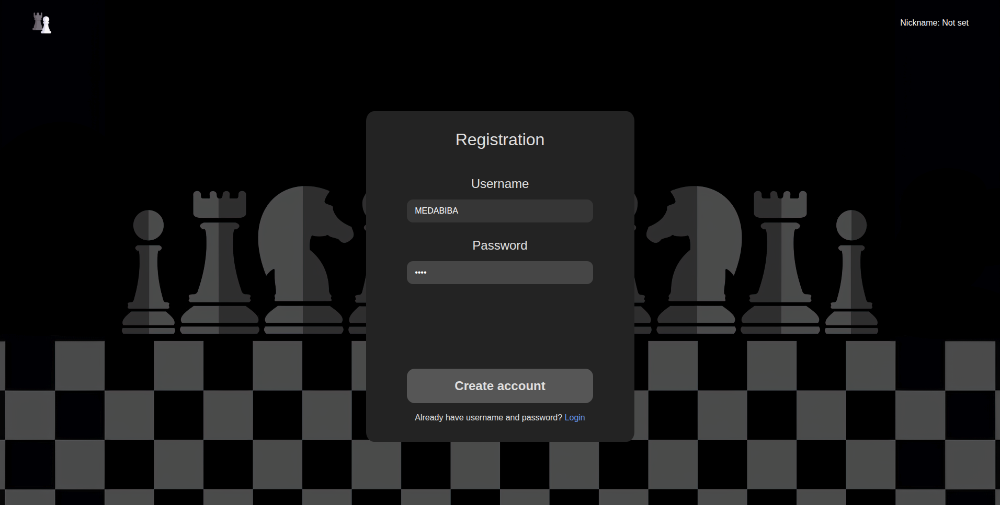
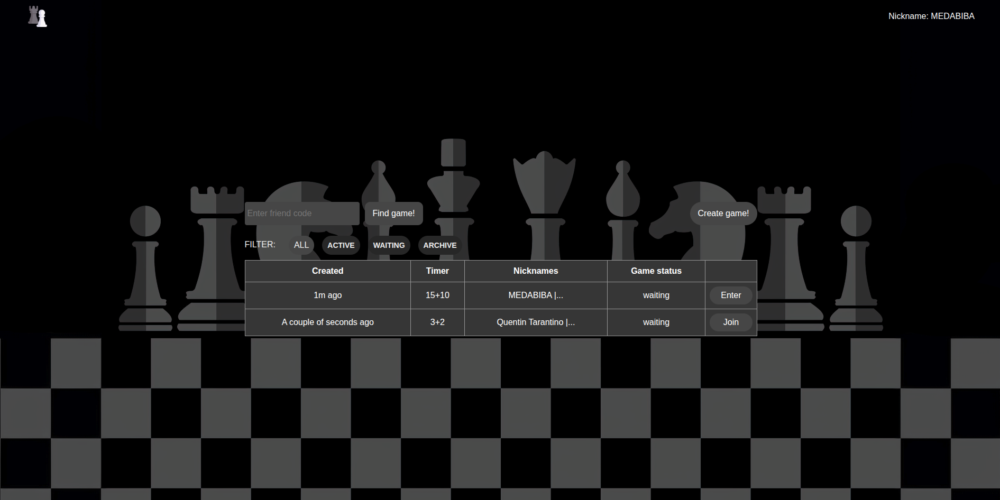
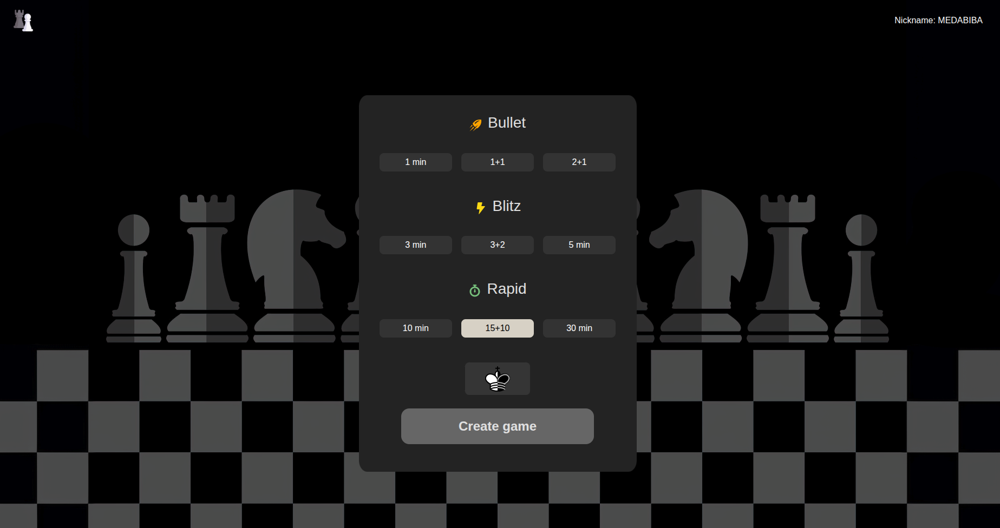
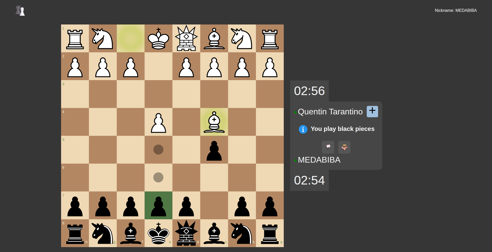
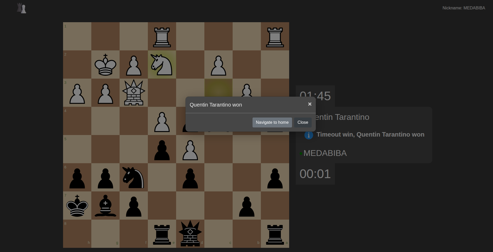

# **Chess**

<div align="center">

[](https://yarnpkg.com/)
[](https://www.typescriptlang.org/)

[](https://react.dev/)
[](https://mobx.js.org/)
[](https://reactrouter.com/)

[](https://www.docker.com/)
[](https://nestjs.com/)
[](https://www.prisma.io/)
[](https://www.postgresql.org/)
[](https://socket.io/)
[](https://jwt.io/)
[](https://github.com/jhlywa/chess.js/)

</div>

### 📰Description

A full-stack real-time multiplayer chess platform built with React and NestJS.

Players can create and join games via invite codes, play with configurable time controls, and interact in real-time through WebSocket connections.
Game state is synchronized between clients and validated server-side
using chess.js to ensure move correctness.

The frontend implements its own board rendering and move logic,
while the backend serves as the authority — validating every move,
managing timers, and persisting game state to PostgreSQL via Prisma ORM.

Services are containerized with Docker Compose for both development
and production environments.

---

### 🌈Features

- Real time synchronization via **WebSocket**
- Game creation with invite codes
- Configurable time control with increment
- Draw offers, resignation, checkmate/stalemate detection
- JWT authentication with refresh token
- Audio accompaniment
- Smooth animation / drag-and-drop
- Toast notifications
- Responsive chessboard with move highlighting

---

### 👨‍💻Getting Started

#### Prerequisites

- **Docker**

### 1. Clone the repository

```bash
git clone https://github.com/MEDABIBA/Chess && cd Chess
```

### 2. Set up environment variables

**Edit backend/.env with your values**:

```bash
cp backend/.env.example backend/.env
```

| Variable       | Description                  |
| -------------- | ---------------------------- |
| `PORT`         | Backend port (default: 3030) |
| `SERVER`       | Frontend origin for CORS     |
| `DATABASE_URL` | PostgreSQL connection string |
| `JWT_SECRET`   | Secret key for JWT signing   |

### 3. Start the docker

**Run containers using docker compose configuration**

### Development(with hot reload):

```bash
docker compose -f compose.dev.yml up --build
```

### Production

```bash
docker compose -f compose.prod.yml up --build
```

### 4. Initialize the database

Synchronize prisma schema with database directly

**For production version:**

```bash
docker compose -f compose.prod.yml exec backend yarn db:push
```

**For developing version:**

```bash
docker compose -f compose.dev.yml exec backend yarn db:push
```

---

### 👷Project Structure

```
Chess/
|-- frontend/ # React 18, MobX, Socket.io-client
|-- backend/ # NestJS, Prisma, chess.js, Socket.io
|-- compose.dev.yml # Development environment
|-- compose.prod.yml # Production environment
```

### Screenshots

<details>
<summary>
Click to expand
</summary>

#### Registration



#### Lobby



#### Game Creation



#### Gameplay



#### Game Over



</details>
